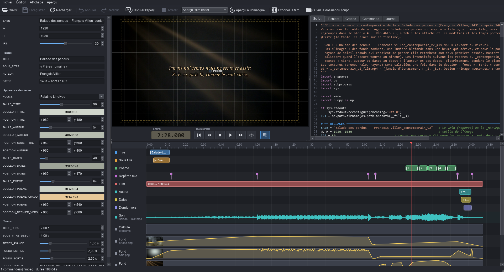

# ffmontage — table de montage pour scripts ffmpeg

[Read in English](README.md)

**ffmontage** est une table de montage pour des films fabriqués par des scripts Python et ffmpeg. Le script reste la
référence : ffmontage le lit, affiche ses réglages dans un panneau et ses temps sur une timeline, calcule des aperçus
et lance l'export. Ce que vous changez à la souris (un fondu, la position d'un titre, le début d'une musique) est
réécrit dans le script, qui fonctionne toujours seul.



Prérequis : Windows, Python 3.12 (`pip install -r requirements.txt`) et ffmpeg dans le PATH. Licence MIT (voir
`LICENSE`).

**Sécurité** : ffmontage exécute les scripts qu'on lui ouvre (c'est ainsi qu'il trouve leurs commandes ffmpeg).
Ouvrir un script, c'est lancer un programme : n'ouvrez que des scripts dont vous connaissez la provenance.

L'onglet **Script** est un éditeur du script (coloration Python, numéros de ligne). C'est la version de travail : le
panneau et la timeline y écrivent leurs changements, et on peut y taper directement ; un seul historique sert à tout
annuler. Dans la marge, la couleur de la piste de chaque ligne étiquetée ; pendant la lecture, les valeurs des blocs
sous la tête sont surlignées (pour une liste, le seul élément concerné) ; un clic sur un bloc montre sa valeur, et le
curseur sur un réglage fait ressortir son bloc.

Les modifications restent en mémoire (● dans le titre ; aperçus et export utilisent déjà cette version) jusqu'à
**Enregistrer** (Ctrl+S), qui écrit le script et affiche les réglages mis à jour et le nombre d'autres lignes
modifiées. Si le script est modifié dans un autre éditeur entre-temps, la table demande quelle version garder.

Onglet **Fichiers** : les fichiers que le script lit et écrit (notés pendant sa lecture, quand il les ouvre avec
`open()`), et ceux de la commande ffmpeg. Double-clic : un texte lu (des vers…) s'ouvre dans un onglet modifiable
(Ctrl+S l'enregistre et relit le script) ; un texte écrit (un `.ass`) en lecture seule ; le reste avec le logiciel de
Windows. Un fichier lu modifié ailleurs fait aussi relire le script.

Onglets : **Graphe** (entrées, chaînes de filtres et sortie de la commande ffmpeg, variables du script),
**Commande** (la commande ffmpeg complète, lisible), **Journal** (messages du script, de ffmpeg, enregistrements).

## Nouveau projet

Mettre les vidéos, photos et la musique dans un dossier (« été 2026 »), puis **Fichier → Nouveau projet…** (Ctrl+N)
et choisir ce dossier. Une fenêtre montre ce que contient le dossier et propose les premiers choix : taille de
l'image, cadence, durée des photos, fondu, animations, titre, son des vidéos, musique (tout reste modifiable dans le
panneau). La table écrit alors « été 2026 film.py », copie de `modeles/film.py` avec ces choix :

- les vidéos et photos du dossier et de ses sous-dossiers (sauf ceux qui commencent par `.` ou `_`), dans l'ordre
  alphabétique de leur nom (numéroter : `01 …`, `02 …`), enchaînées par un fondu ; chacune mise à la taille du film
  (bandes de `COULEUR_FOND` si sa forme diffère) ;
- les animations : une suite d'au moins `SUITE_MIN` images numérotées de même nom (`rendu_0001.png`…, en .png, .tif,
  .bmp ou .webp ; les .jpg restent des photos) forme un seul plan, à `SUITE_IPS` images/s ; s'il manque des images,
  chacune dure jusqu'à la suivante. Si le film commence par une animation à sa cadence, le compteur IMAGE donne ses
  numéros ;
- un titre au début (texte, police, taille, couleur, position, temps ; vide : pas de titre) ;
- le son des vidéos (`SON_VIDEOS`, `VOLUME_VIDEOS`), en fondu avec elles ;
- toutes les musiques du dossier enchaînées en fondu (ou celle de `MUSIQUE`), reprises si elles sont plus courtes
  que le film (`MUSIQUE_BOUCLE`), baissées pendant le son des vidéos (`MUSIQUE_SOUS_VIDEOS`), avec volume, retard et
  fondu final ;
- le film « été 2026_film.mp4 » dans le dossier. « Résultats du script » dans le panneau : la durée du film, les
  plans trouvés, les vidéos dont le son est gardé, les musiques utilisées.

Des médias ajoutés ensuite : F5 pour relire. Le script est un point de départ, à modifier dans l'onglet Script.

## Lancer

- Depuis les sources : `Lancer.bat` (ou `.venv\Scripts\python TableDeMontage.py [script.py]`).
- Version compilée : `TableDeMontage.exe [script.py]`.

Raccourcis : Ctrl+N nouveau projet · Ctrl+O ouvrir · Ctrl+S enregistrer · F5 recharger · Ctrl+Z annuler · Ctrl+Y rétablir · F6 aperçu · Espace lecture/pause · Ctrl+E exporter · Échap arrêter ·
Ctrl+molette sur la timeline : zoom.
Tête de lecture (après un clic sur la timeline ou la vidéo) : ←/→ une image · Maj+←/→ 1 s · Ctrl+←/→ 10 s ·
Début/Fin. Sous l'aperçu, DURÉE et IMAGE : le numéro de l'image sous la tête, à partir de 1 (d'après `IPS`), pour
retrouver l'image dans le logiciel qui l'a rendue ; si le script définit `PAS_IMAGES` (images rendues de N en N),
celle qui est à l'écran : 1, 11, 21… ; avec `NB_IMAGES` (numéro de la dernière image), il reste sur elle pendant
une fin tenue ; avec `NUMEROS_IMAGES` (liste des images rendues, le montage commençant à la première : une portion
150-250…), leurs vrais numéros, et « noir » dans les trous ; avec `DEBUT_IMAGES` (moment de la timeline, en
secondes, où apparaît la première image, après un titre), il compte à partir de là et montre « titre » avant.

## La convention du script

Un bloc de réglages en tête de script, entre deux lignes repères :

```python
# ── RÉGLAGES ──────────────────────────────
TITRE = "Ballade des pendus"            # le texte du titre
IPS = 30                                # images par seconde [1..60] @apercu=10
# ── Temps
TITRE_DEBUT = 2.0                       # le titre apparaît @Titre.debut
FONDU = 0.8                             # s · fondu enchaîné [0..3]
DEBUT = TITRE_DEBUT + 1.2               # calculé : affiché, non modifiable @Animation.debut
VERS = [(146.0, 151.9), (152.4, 157.1)] # (début, fin) de chaque distique @Poème.intervalles
# ── FIN RÉGLAGES ──────────────────────────
```

- **Valeurs littérales** (nombre, texte, booléen, liste…) : modifiables dans le panneau. Le reste de la ligne, et du
  fichier, n'est jamais touché.
- **Valeurs calculées** à partir des réglages précédents (opérations, `round`, `min`, `max`, f-strings) : affichées,
  et suivies en direct sur la timeline pendant un glissement.
- `# ── Titre` dans le bloc : une section du panneau, titrée par son premier mot ou groupe de mots (ce qui suit
  « ( », « : » ou « — » va dans la bulle d'aide).
- Le commentaire de la ligne (ou les lignes de commentaire juste au-dessus), les pistes reliées et la valeur
  d'aperçu sont dans la bulle d'aide du nom du réglage. Un commentaire qui commence par « s · », ou une valeur
  reliée à un début, une fin, une durée ou un repère, affiche « s » dans la case du nombre.

Étiquettes dans le commentaire :

| Étiquette | Effet |
|---|---|
| `[min..max]` | bornes du champ ; curseur si les deux sont données |
| `@Piste.debut`, `.fin`, `.duree` | bloc sur la piste « Piste » de la timeline (secondes depuis le début du film) |
| `@Piste.marque` | un repère |
| `@Piste.intervalles` | une liste de paires (début, fin) : un bloc par paire |
| `@Piste.marques` | une liste de temps : un repère par valeur |
| `@Piste.texte`, `.police`, `.taille`, `.couleur`, `.position` | l'apparence d'un texte du film : liste des polices, choix de couleur (`"#RRGGBB"`), X / Y ; la position (x, y) en pixels de l'image a une poignée sur l'aperçu, à faire glisser (bouton grille : grille d'accrochage et zone de sécurité ; Maj : sans aimant) |
| `@couleur`, `@police`, `@position` | les mêmes outils pour une valeur sans piste |
| `@fichier`, `@dossier` | bouton de choix (chemin relatif au `@dossier` du bloc, sinon au dossier du script) |
| `@apercu=valeur` | valeur utilisée seulement pour les aperçus (ex. moins d'images par seconde) |
| `@resultat` | (hors du bloc) la valeur en fin d'exécution, dans le panneau sous « Résultats du script » |
| `@nom=Nom_affiché` | le nom du réglage dans le panneau, à la place du nom de la variable (les `_` deviennent des espaces) ; pour `W, H = …` : `@nom=Largeur,Hauteur` |

Une valeur peut porter plusieurs étiquettes (`@Animation.debut @Musique.debut`). Les `_` des noms de piste
s'affichent comme des espaces.

**Hors du bloc**, une ligne en MAJUSCULES au premier niveau du script peut aussi porter des étiquettes
(`BOUCLE, PIANO = R["…"], R["…"]  # @Musique.marque`) : la valeur est celle qu'avait la variable à la fin du script
(lecture seule). C'est ce qui permet d'afficher des temps lus dans un `.mid`. Avec l'étiquette `@resultat`, la
valeur s'affiche aussi dans le panneau, sous « Résultats du script » (`NB_IMAGES = len(images)  # @resultat` : ce
que le script a trouvé, sans ouvrir le journal).

## Ce que fait la table

- **Lecture du script** (à l'ouverture et après chaque modification) : le script est exécuté dans un processus
  séparé, mais ses appels à ffmpeg (par `subprocess`) sont interceptés au lieu d'être exécutés. La table en tire le
  graphe de filtres, la commande, les repères de temps des filtres (`xfade`, `fade`, `adelay`, sous-titres `.ass`…)
  et les valeurs des variables en MAJUSCULES. Le reste du script s'exécute vraiment : les fichiers qu'il écrit avant
  ffmpeg (un `.ass`, des textures…) sont écrits.
- **Aperçu** : la dernière commande ffmpeg, encodée en `ultrafast`, vers un fichier temporaire ; le film entier ou un
  extrait depuis la tête de lecture. ffmpeg doit calculer tout ce qui précède l'extrait : plus il est loin, plus c'est
  long ; `@apercu=` aide.
- **Export** : le script lancé normalement, avec la progression de ffmpeg.
- Le script est surveillé : modifié dans un éditeur, il est relu.

Limites : les appels à ffmpeg faits autrement que par `subprocess` (`os.system`…) ne sont pas vus ; une commande
préparatoire qui reçoit ses données sur l'entrée standard n'est pas rejouée pour l'aperçu.

## Construire l'exécutable

`build.ps1` (PyInstaller, puis Inno Setup 6 s'il est installé) produit dans `dist\` :

- `TableDeMontage\` : `TableDeMontage.exe`, `lanceur.exe` (exécute les scripts, avec Python, numpy et mido
  embarqués), `bin\ffmpeg.exe` et `bin\ffprobe.exe` ;
- `TableDeMontage-portable.zip` : la même chose avec `portable.txt` (données à côté de l'exe) ;
- `TableDeMontage-setup-<version>.exe` : l'installateur (ex. `TableDeMontage-setup-1.0.0.exe`).

Version : `MAJEUR.MINEUR.CORRECTIF`, écrite seulement dans `tablemontage/__init__.py` (titre de la fenêtre,
installateur) : correctif +1 pour une correction, mineur +1 pour une nouvelle fonction, majeur +1 si d'anciens
scripts ou réglages ne marchent plus.

Un module dont un script a besoin doit être ajouté à `tablemontage/modules_scripts.py` avant de recompiler.
ffmpeg avec libx264 est sous licence GPL : pour redistribuer l'exécutable avec `bin\ffmpeg.exe`, il faut respecter
la GPL (indiquer où trouver les sources de ffmpeg).

## Organisation

| Fichier | Rôle |
|---|---|
| `TableDeMontage.py`, `lanceur.py` | points d'entrée (interface, exécution des scripts) |
| `tablemontage/application.py` | démarrage : thème sombre, icône, fenêtre |
| `tablemontage/fenetre.py` | la fenêtre : actions, onglets, aperçu, export, enregistrement |
| `tablemontage/panneau.py` | le panneau des réglages |
| `tablemontage/timeline.py` | la timeline : pistes, sons, médias, courbes, transitions |
| `tablemontage/vue_apercu.py`, `transport.py` | l'aperçu (poignées des textes, grille) et sa barre de transport |
| `tablemontage/editeur.py`, `fichiers.py` | l'onglet Script, l'onglet Fichiers et les onglets de fichiers texte |
| `tablemontage/reglages.py` | lecture et réécriture du bloc de réglages |
| `tablemontage/fichier_texte.py` | lire et réécrire un fichier texte sans changer son BOM, ses fins de ligne, son encodage |
| `tablemontage/lanceur.py` | exécution d'un script : capture des commandes ffmpeg ou export |
| `tablemontage/ffmpeg_analyse.py` | analyse d'une commande ffmpeg, commande d'aperçu |
| `tablemontage/son.py` | formes d'onde des sons |
| `tablemontage/taches.py` | processus en arrière-plan (lanceur, ffmpeg) |
| `tablemontage/projet.py`, `tablemontage/dialogue_projet.py`, `modeles/film.py` | « Nouveau projet », sa fenêtre d'options et son script de départ |
| `tablemontage/chemins.py` | chemins valables en sources comme en exécutable |
| `tablemontage/modules_scripts.py` | modules embarqués dans l'exécutable pour les scripts de film |
| `icones/`, `tablemontage/icones.py` | icônes SVG 16×16 en `currentColor` (style du mixeur), colorées au chargement |
| `outils/faire_icone.py` | fabrique `application.ico` et `.png` à partir de `application.svg` |

Annuler / Rétablir portent sur tout le texte du script (un seul historique) : les changements du panneau et de la
timeline (une suite rapide de retouches du même réglage compte pour une) comme la frappe dans l'onglet Script.
