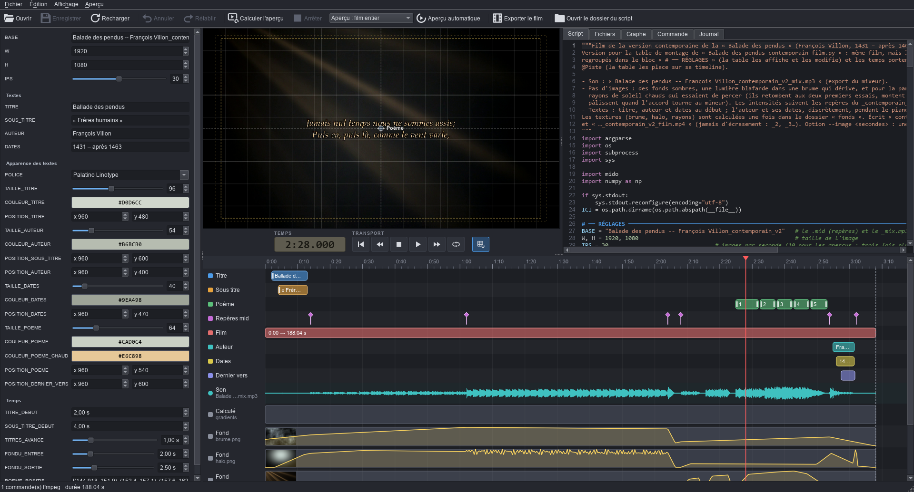

# ffmontage — an editing desk for ffmpeg scripts

[Lire en français](README.fr.md)

**ffmontage** is a video editing desk for films made by Python scripts and ffmpeg. The script remains the source of
truth: ffmontage reads it, shows its settings in a panel and its timings on a timeline, renders previews and runs the
export. Whatever you change with the mouse (a fade, the position of a title, the start of a piece of music) is written
back into the script, which still runs on its own.



Requirements: Windows, Python 3.12 (`pip install -r requirements.txt`) and ffmpeg in the PATH. MIT licence (see
`LICENSE`).

The interface and the script convention are in French: menu names, panel labels and tags (`@Piste.debut`,
`# ── RÉGLAGES`…) are quoted below as they appear, with their meaning.

**Security**: ffmontage runs the scripts you open (that is how it finds their ffmpeg commands). Opening a script means
running a program: only open scripts whose origin you know.

The **Script** tab is an editor for the script (Python highlighting, line numbers). It is the working copy: the panel
and the timeline write their changes into it, and you can type in it directly; a single history undoes everything. The
margin shows the track colour of each tagged line; during playback, the values of the blocks under the playhead are
highlighted (for a list, only the element concerned); clicking a block shows its value, and putting the cursor on a
setting highlights its block.

Changes stay in memory (● in the title; previews and export already use this version) until **Enregistrer** (Save,
Ctrl+S), which writes the script and reports the updated settings and the number of other changed lines. If the script
was changed in another editor in the meantime, ffmontage asks which version to keep.

**Fichiers** (Files) tab: the files the script reads and writes (recorded while it runs, when it opens them with
`open()`), and those of the ffmpeg command. Double-click: a text it reads (verses…) opens in an editable tab (Ctrl+S
saves it and re-reads the script); a text it writes (a `.ass`) opens read-only; anything else opens with the Windows
application. A read file changed elsewhere also makes the script be read again.

Other tabs: **Graphe** (inputs, filter chains and output of the ffmpeg command, script variables), **Commande** (the
full ffmpeg command, readable), **Journal** (log: messages from the script, from ffmpeg, saves).

## New project

Put the videos, photos and music in a folder (« été 2026 »), then **Fichier → Nouveau projet…** (File → New project,
Ctrl+N) and choose that folder. ffmontage writes « été 2026 film.py » into it, a copy of `modeles/film.py`:

- the videos and photos of the folder and its subfolders (except those starting with `.` or `_`), in alphabetical
  order of their names (number them: `01 …`, `02 …`), linked by crossfades; each one fitted to the film size (bars of
  `COULEUR_FOND` if its shape differs);
- a title at the start (text, font, size, colour, position, timing);
- the first music file of the folder, or the one in `MUSIQUE`, with volume, delay and final fade;
- the film « été 2026_film.mp4 » in the folder.

Media added later: F5 to re-read. The script is a starting point, to be edited in the Script tab.

## Running

- From the sources: `Lancer.bat` (or `.venv\Scripts\python TableDeMontage.py [script.py]`).
- Built version: `TableDeMontage.exe [script.py]`.

Shortcuts: Ctrl+N new project · Ctrl+O open · Ctrl+S save · F5 reload · Ctrl+Z undo · Ctrl+Y redo · F6 preview ·
Space play/pause · Ctrl+E export · Esc stop · Ctrl+wheel on the timeline: zoom.
Playhead (after clicking the timeline or the video): ←/→ one frame · Shift+←/→ 1 s · Ctrl+←/→ 10 s · Home/End.

## The script convention

A settings block at the top of the script, between two marker lines:

```python
# ── RÉGLAGES ──────────────────────────────
TITRE = "Ballade des pendus"            # le texte du titre
IPS = 30                                # images par seconde [1..60] @apercu=10
# ── Temps
TITRE_DEBUT = 2.0                       # le titre apparaît @Titre.debut
FONDU = 0.8                             # s · fondu enchaîné [0..3]
DEBUT = TITRE_DEBUT + 1.2               # calculé : affiché, non modifiable @Animation.debut
VERS = [(146.0, 151.9), (152.4, 157.1)] # (début, fin) de chaque distique @Poème.intervalles
# ── FIN RÉGLAGES ──────────────────────────
```

(`RÉGLAGES` = settings, `FIN RÉGLAGES` = end of settings; variable names and comments are free.)

- **Literal values** (number, text, boolean, list…): editable in the panel. The rest of the line, and of the file, is
  never touched.
- **Values computed** from earlier settings (arithmetic, `round`, `min`, `max`, f-strings): displayed, and followed
  live on the timeline while dragging.
- `# ── Titre` inside the block: a section of the panel, titled by its first word or group of words (whatever
  follows « ( », « : » or « — » goes into the tooltip).
- The comment of the line (or the comment lines just above it), the linked tracks and the preview value are in the
  tooltip of the setting's name. A comment starting with « s · », or a value linked to a start, an end, a duration or
  a marker, shows « s » (seconds) in the number field.

Tags in the comment:

| Tag | Effect |
|---|---|
| `[min..max]` | bounds of the field; a slider if both are given |
| `@Piste.debut`, `.fin`, `.duree` | start, end, duration: a block on the timeline track « Piste » (seconds from the start of the film) |
| `@Piste.marque` | a marker |
| `@Piste.intervalles` | a list of (start, end) pairs: one block per pair |
| `@Piste.marques` | a list of times: one marker per value |
| `@Piste.texte`, `.police`, `.taille`, `.couleur`, `.position` | text, font, size, colour, position of a text in the film: font list, colour picker (`"#RRGGBB"`), X / Y; the position (x, y) in image pixels has a handle on the preview, to drag (grid button: snapping grid and safe area; Shift: no snapping) |
| `@couleur`, `@police`, `@position` | the same tools for a value without a track |
| `@fichier`, `@dossier` | file / folder picker (path relative to the block's `@dossier`, otherwise to the script's folder) |
| `@apercu=valeur` | value used only for previews (e.g. fewer frames per second) |
| `@resultat` | (outside the block) the value at the end of the run, in the panel under "Résultats du script" |
| `@nom=Nom_affiché` | the setting's name in the panel, instead of the variable name (`_` become spaces); for `W, H = …`: `@nom=Largeur,Hauteur` |

A value can carry several tags (`@Animation.debut @Musique.debut`). The `_` in track names are shown as spaces.

**Outside the block**, an UPPERCASE line at the top level of the script can also carry tags
(`BOUCLE, PIANO = R["…"], R["…"]  # @Musique.marque`): the value is the one the variable had at the end of the
script (read-only). This is how times read from a `.mid` file can be shown. With the `@resultat` tag, the value is
also shown in the panel, under "Résultats du script" (`NB_IMAGES = len(images)  # @resultat`: what the script found,
without opening the log).

## What ffmontage does

- **Reading the script** (on opening and after each change): the script runs in a separate process, but its calls to
  ffmpeg (through `subprocess`) are intercepted instead of being executed. ffmontage extracts the filter graph, the
  command, the timings found in the filters (`xfade`, `fade`, `adelay`, `.ass` subtitles…) and the values of the
  UPPERCASE variables. The rest of the script really runs: the files it writes before ffmpeg (a `.ass`, textures…)
  are written.
- **Preview**: the last ffmpeg command, encoded `ultrafast` into a temporary file; the whole film or an excerpt from
  the playhead. ffmpeg has to compute everything before the excerpt: the further it is, the longer it takes;
  `@apercu=` helps.
- **Export**: the script run normally, with ffmpeg's progress.
- The script is watched: changed in an editor, it is read again.

Limits: calls to ffmpeg made other than through `subprocess` (`os.system`…) are not seen; a preparatory command fed
through standard input is not replayed for the preview.

## Building the executable

`build.ps1` (PyInstaller, then Inno Setup 6 if installed) produces in `dist\`:

- `TableDeMontage\`: `TableDeMontage.exe`, `lanceur.exe` (runs the scripts, with Python, numpy and mido bundled),
  `bin\ffmpeg.exe` and `bin\ffprobe.exe`;
- `TableDeMontage-portable.zip`: the same with `portable.txt` (data stored next to the exe);
- `TableDeMontage-setup-<version>.exe`: the installer (e.g. `TableDeMontage-setup-1.0.0.exe`).

Version: `MAJOR.MINOR.PATCH`, written only in `tablemontage/__init__.py` (window title, installer): patch +1 for a
fix, minor +1 for a new feature, major +1 if older scripts or settings stop working.

A module a script needs must be added to `tablemontage/modules_scripts.py` before rebuilding. ffmpeg with libx264 is
GPL-licensed: to redistribute the executable with `bin\ffmpeg.exe`, you must comply with the GPL (say where to find
ffmpeg's sources).

## Layout

| File | Role |
|---|---|
| `TableDeMontage.py`, `lanceur.py` | entry points (interface, running scripts) |
| `tablemontage/application.py` | start-up: dark theme, icon, window |
| `tablemontage/fenetre.py` | the window: actions, tabs, preview, export, saving |
| `tablemontage/panneau.py` | the settings panel |
| `tablemontage/timeline.py` | the timeline: tracks, sounds, media, curves, transitions |
| `tablemontage/vue_apercu.py`, `transport.py` | the preview (text handles, grid) and its transport bar |
| `tablemontage/editeur.py`, `fichiers.py` | the Script tab, the Files tab and the text file tabs |
| `tablemontage/reglages.py` | reading and rewriting the settings block |
| `tablemontage/fichier_texte.py` | reading and rewriting a text file without changing its BOM, line endings or encoding |
| `tablemontage/lanceur.py` | running a script: capturing ffmpeg commands, or export |
| `tablemontage/ffmpeg_analyse.py` | analysis of an ffmpeg command, preview command |
| `tablemontage/son.py` | sound waveforms |
| `tablemontage/taches.py` | background processes (launcher, ffmpeg) |
| `tablemontage/projet.py`, `modeles/film.py` | « New project » and its starter script |
| `tablemontage/chemins.py` | paths valid from sources and from the executable |
| `tablemontage/modules_scripts.py` | modules bundled in the executable for film scripts |
| `icones/`, `tablemontage/icones.py` | 16×16 SVG icons in `currentColor`, coloured when loaded |
| `outils/faire_icone.py` | builds `application.ico` and `.png` from `application.svg` |

Undo / Redo cover the whole text of the script (a single history): changes from the panel and the timeline (a quick
series of tweaks to the same setting counts as one) as well as typing in the Script tab.
